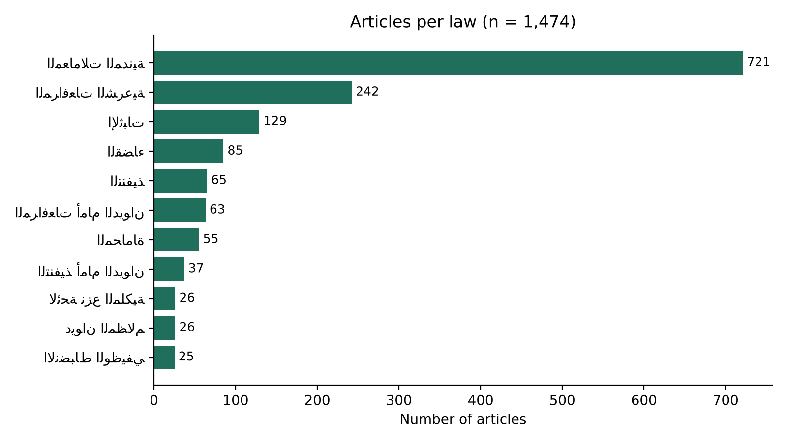
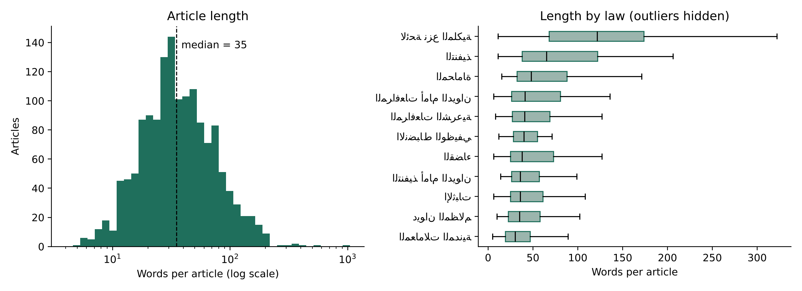
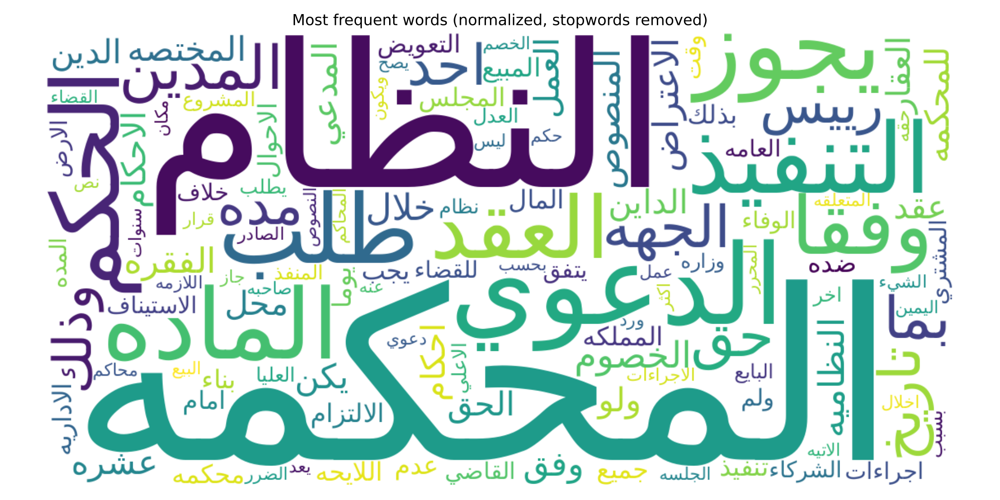
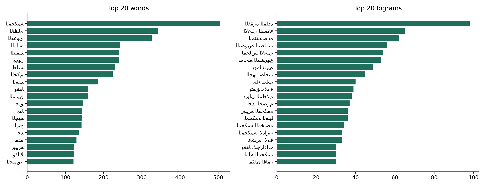
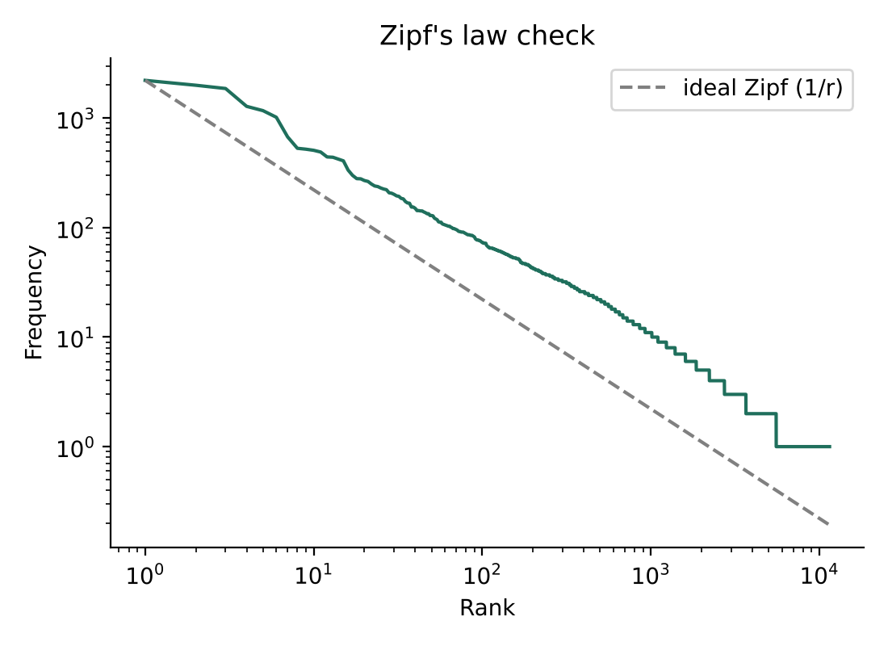
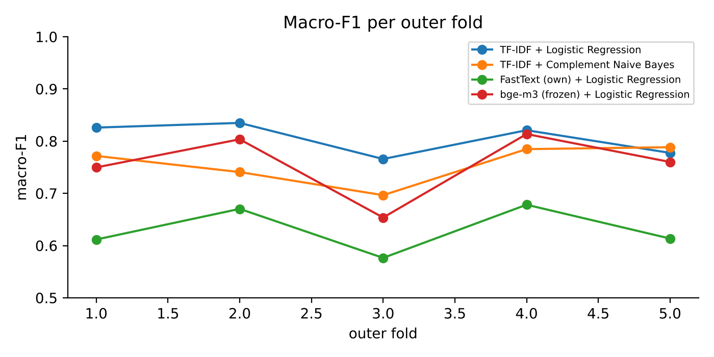
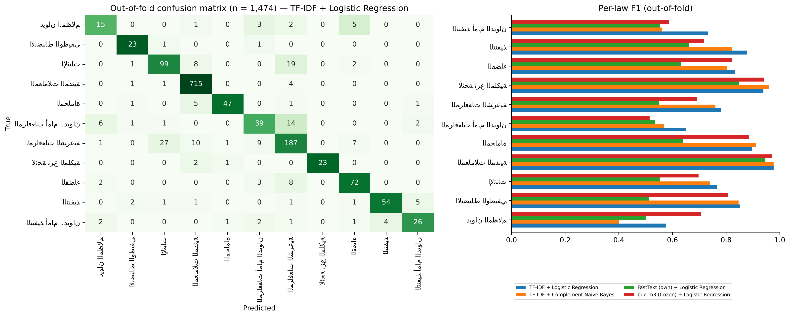
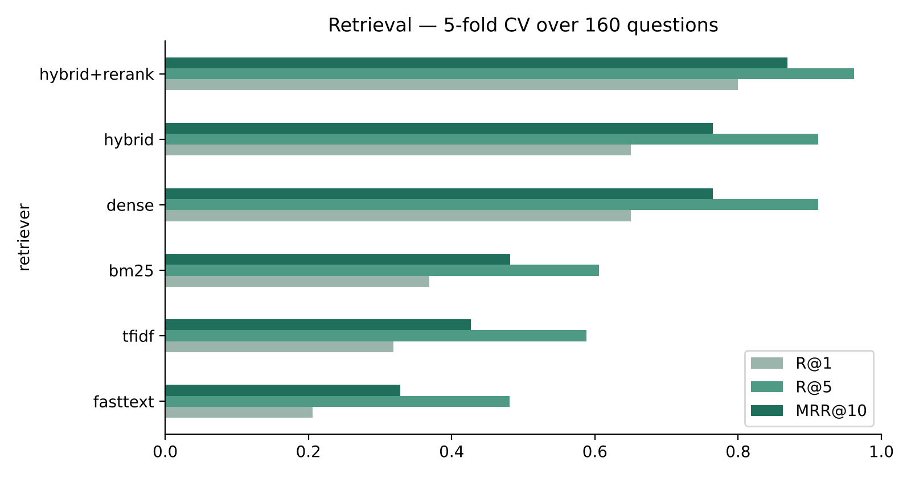
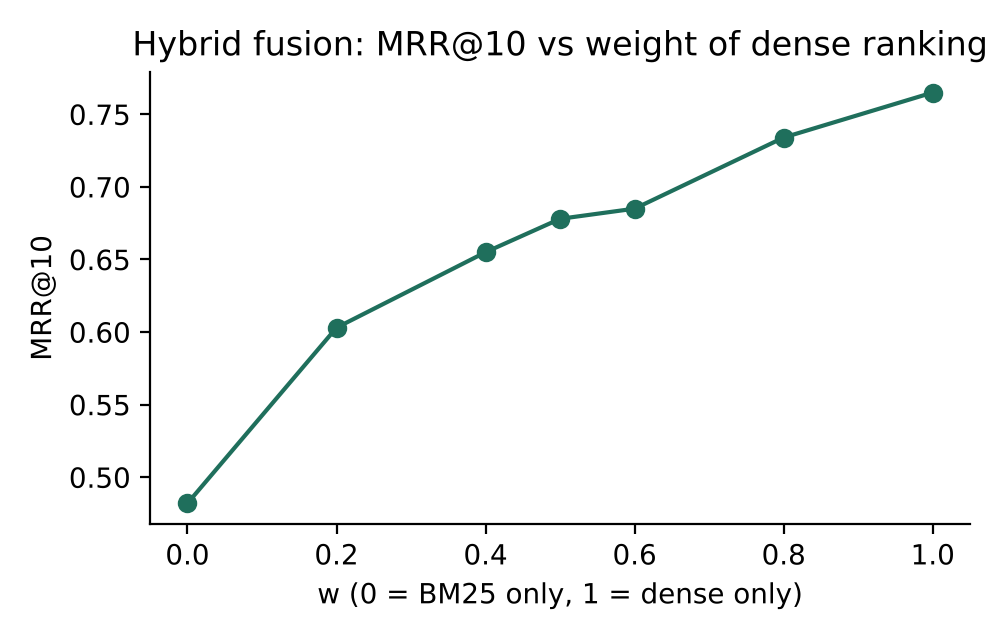

# Saudi Legal RAG — Project Report

*Companion to `Saudi_Legal_RAG.ipynb`: every design decision, insight and finding, section by section. Numbers come from the notebook run.*
**NLP Course Project** · University of Bisha · Group **[GROUP NUMBER]**

| Member | Role |
|---|---|
| [Name 1] | [e.g. data collection & preprocessing] |
| [Name 2] | [e.g. modeling & evaluation] |
| [Name 3] | [e.g. EDA, presentation] |

**Research question.** *Given a user's Arabic legal question about litigating against a government body, can we
retrieve the article of Saudi law that answers it — and which text representation does this best?*

**NLP task.** Information retrieval for Retrieval-Augmented Generation (RAG) — ranking 1,474 law articles per question.
**Target.** The governing article(s) for each question (`gold_ids`).
**Supporting task.** Text classification — predicting which law an article belongs to (11 classes).

> **Acknowledgement of tools.** Open-source libraries: scikit-learn, gensim, rank_bm25, sentence-transformers
> (BAAI/bge-m3, BAAI/bge-reranker-v2-m3), matplotlib, wordcloud. An AI assistant (Claude) was used to help write
> code and to draft the evaluation questions marked `source = ai` (each written from its gold article, then checked);
> questions marked `source = team` were written by the team members. The corpus itself (1,474 articles) is real
> legislation collected from the official source — no corpus text was generated.

## 1. Data collection

**Source.** The Bureau of Experts at the Council of Ministers — [laws.boe.gov.sa](https://laws.boe.gov.sa), the
official consolidated text of Saudi legislation.

**Scope.** 11 laws a person meets when taking a dispute with a government body to the Board of Grievances
(ديوان المظالم): the Board's own laws, the procedural laws it applies, and the substantive civil law used in
compensation and contract claims.

**Tool.** `src/scraper.py` — `requests` + `BeautifulSoup(lxml)`. One request at a time, 2 s delay between laws.
It keeps only the **in-force** text of each article; superseded versions shown in pop-ups are skipped.
The site returned an error page for the main expropriation law (نظام نزع الملكية), so only its executive
regulation is included.

**Ethics.** Public government legislation, no personal data, low request rate, used only for this
academic project. Collection date: November 2026.

**Unit of analysis = one article (المادة).** Legal meaning and legal citation both live at the article level.

## 2. Dataset description

## 3. Preprocessing

The **same** function is applied to articles and questions. Otherwise a question typed with `اذا`
would never match `إذا` in the law.

| Step | Why |
|---|---|
| Arabic-Indic digits → ASCII | `١٥` and `15` are the same number |
| Remove diacritics (tashkeel) and tatweel | legal text is partly vocalized, user questions are not |
| Letter normalization: أ/إ/آ/ٱ → ا, ى → ي, ة → ه, ؤ → و, ئ → ي | the most common spelling variation in typed Arabic |
| Remove punctuation and digits (lexical models only) | article numbers inside sentences add noise to word matching |
| Remove stopwords (normalized list) | function words such as على / إلى / التي carry no retrieval signal |
| Light stemming: strip ال / وال / بال / لل … | `الدعوى`, `والدعوى`, `بالدعوى` → one term |

**Not applied:** lowercasing (Arabic has no case), aggressive root stemming (it merges unrelated legal terms).
The contextual model (bge-m3) only receives normalized text. It has its own sub-word tokenizer and needs the
function words.

**Insight.** Every step shrinks the vocabulary. Light stemming alone removes about 1,800 word types, mostly
the same word with and without `ال`. A smaller vocabulary means a user's wording and the law's wording meet
on the same term more often. This matters most for the lexical models (TF-IDF, BM25).

**Duplicates and short entries.** The only duplicates are boilerplate final articles (e.g. *"يعمل بهذا النظام…"*)
that appear in more than one law. They are **kept**, because each one is a separate, citable article.
Very short articles are also kept: the shortest article can be the full answer to a question.

## 4. Exploratory data analysis

**Insight — strong imbalance.** The Civil Transactions Law alone is about half of the corpus (721 of 1,474 articles).
Three laws have fewer than 30 articles. For retrieval, this means a question about the Board of Grievances
competes with hundreds of civil-law articles that use similar vocabulary (عقد، تعويض، حق). For the classification
experiment, we must use **macro-F1** and class weights; plain accuracy would reward predicting the big class.

**Insight — short, heavy-tailed documents.** The median article has 35 words, but a few run past 1,000 words. The
executive regulation of the expropriation law is about 3× longer per article than the other laws. Length affects
modeling: BM25 normalizes for document length, plain TF-IDF cosine only partly, and the transformer truncates
at 512 tokens. That limit covers more than 99% of the articles.

**Insight — a procedural vocabulary.** The most frequent words are court-procedure terms: المحكمة، الدعوى،
الحكم، التنفيذ، طلب. Bigrams are fixed legal collocations such as *المنصوص عليها*, *المجلس الأعلى للقضاء*,
*المنفذ ضده*. Two consequences:
1. Many articles share the same high-frequency terms, so **single-word matching cannot separate them**.
   Word bigrams, which TF-IDF uses here, and contextual models are needed.
2. Users rarely write these collocations, so there is a **vocabulary gap** between questions and law text.
   This motivates semantic (embedding) retrieval.

**Insight.** Word frequencies follow Zipf's law closely, with a long tail of rare words. Many terms in a user
question will appear in only a handful of articles. These rare terms are the most informative ones,
which is exactly what IDF weighting rewards.

## 5. Text representations

| Representation | Type | Fitted on |
|---|---|---|
| **TF-IDF** (word uni+bigrams, sublinear tf) | Bag-of-Words, sparse | our corpus |
| **BM25** (Okapi, k1 = 1.5, b = 0.75) | Bag-of-Words, probabilistic | our corpus |
| **FastText** (skip-gram, 200-d, char 2–5-grams) | static word embeddings | trained on our corpus |
| **bge-m3** (XLM-RoBERTa, 1024-d) | contextual sentence embeddings | pretrained, multilingual |
| **bge-reranker-v2-m3** | cross-encoder (question + article read together) | pretrained |

FastText rather than Word2Vec: Arabic morphology produces many surface forms. Character n-grams give a vector even
to word forms that never appear in the corpus but do appear in user questions.

**Insight.** With only about 50k training tokens, FastText's neighbours are mostly *surface-form* relatives:
inflections of the same word (تعويض → تعويضات، بتعويض) or words that merely share letters
(استيناف → استيناس، استيذان). The character n-grams handle morphology well, but the model has not seen enough
text to learn legal *meaning*. We expect it to be the weakest semantic retriever; a pretrained model is needed for meaning.

## 6. Experiment A — Law classification ("law router")

*Can a model tell which law an article comes from, using only its text?* The labels are real metadata: the
law the article was published in. This gives a supervised task with held-out evaluation. It is also a component
a RAG system could use to narrow its search.

**Why not a single 80 / 20 split?** With 11 classes and the smallest laws holding only about 25 articles, one
80 / 20 split leaves about 5 test articles for those laws. One mistake moves their F1 by about 20 points, and the
headline number depends on which articles happened to land in the test set.

**Protocol — nested stratified cross-validation.**
- **Outer loop: 5 stratified folds.** Every article is tested exactly once, by a model that never saw it.
  We report **mean ± standard deviation over the 5 folds**. The confusion matrix uses the out-of-fold predictions
  of **all 1,474 articles**, not just 295.
- **Inner loop: 3 stratified folds** inside each outer training part, used only to choose hyperparameters
  (`GridSearchCV`). The outer test fold never takes part in tuning, so there is no leakage.
- Input is the article **body** only (law name and chapter removed). The TF-IDF vocabulary and the FastText
  model are refit inside every training fold.
- Imbalance is handled with `class_weight="balanced"` and Complement NB. Models are ranked by **macro-F1**,
  which weighs every law equally.

**Findings (Experiment A).** *(mean ± std over 5 outer folds)*
- **TF-IDF + Logistic Regression is the best model**: accuracy ≈ 0.88 ± 0.01, macro-F1 ≈ 0.81 ± 0.03. Each law has its
  own technical vocabulary (المنفذ ضده in enforcement, الخصوم in procedure, المبيع in civil transactions), and a linear
  model on sparse uni+bigrams uses exactly those terms.
- **Complement NB (≈ 0.76) and frozen bge-m3 (≈ 0.76) tie for second.** bge-m3 has the largest fold-to-fold spread
  (± 0.06). Its vectors encode *what an article means*, not *which law's drafting style it uses*, so two
  procedure laws saying the same thing look alike to it.
- **FastText trained on our corpus is clearly last (≈ 0.63).** About 50k tokens is too little to train good
  embeddings, and averaging word vectors blurs the few discriminative terms.
- **Cross-validation changed the conclusion's confidence, not its direction.** A single 80/20 split we tried first
  gave the top model macro-F1 0.90. Across 5 folds it is 0.81 ± 0.03, with individual folds between 0.77 and 0.84.
  The single split was optimistic. CV gives the honest number and its uncertainty.
- **Errors are legally sensible.** 174 of 1,474 articles are misclassified. The top confusions are
  Sharia Procedure ↔ Evidence (27 + 19) and Board-of-Grievances Procedure → Sharia Procedure (14). These laws
  regulate the same steps (الدعوى، الإقرار، الشهادة، الاعتراض), and the Board procedure law explicitly refers back
  to the Sharia Procedure Law. The weakest classes are the smallest Board laws (ديوان المظالم F1 ≈ 0.58,
  المرافعات أمام الديوان ≈ 0.65). Civil Transactions is almost perfect (≈ 0.98).

## 7. Experiment B — Retrieval for RAG (main task)

**Evaluation questions** (`eval/questions.csv`), each labeled with its governing article(s):

| source | how it was made |
|---|---|
| `ai` | 160 questions drafted with an AI assistant from a stratified sample of articles (all 11 laws), in formal and colloquial Arabic, then checked |
| `team` | questions written by the team members in their own words, labeled with `app/annotate.py` |

Results are reported **overall and per source**. AI-drafted questions are written while looking at the article, so
they may share more wording with it than a real user's question would. Comparing the two sources makes that bias
measurable instead of hidden.

**Protocol — 5-fold cross-validation over the questions** (folds stratified by source).
Only the hybrid fusion has a hyperparameter: the weight *w* of the dense ranking. For each fold, *w* is chosen on
the other 4 folds and applied to the held-out fold. Every question is scored exactly once by a configuration that
never saw it during tuning, and **all** questions count, rather than a small fixed test set.
The other retrievers have nothing to tune and are scored on all questions.
Metrics: Recall@k (a correct article in the top k), MRR@10 (1 / rank of the first correct article), nDCG@10.
95% bootstrap confidence intervals are given for MRR.

**Findings (Experiment B).** *(5-fold CV, 160 questions; numbers from the table above)*
- **Semantic retrieval dominates.** bge-m3 finds a correct article in the top 5 for **91%** of questions
  (R@1 0.65, MRR 0.77). BM25 manages **61%** (MRR 0.48) and TF-IDF **59%**. The questions use everyday wording
  («كم عندي وقت»، «وش يصير») while the law uses formal drafting, and only embeddings bridge that gap.
- **Fusion did not help here.** Hybrid MRR rises steadily with the dense weight: 0.48 at w = 0, 0.68 at 0.5,
  0.77 at 1.0. Every fold chose **w = 1.0**, i.e. dense only. When one retriever is this much stronger, BM25's
  rankings add noise rather than complementary signal. Lexical retrieval found only **4** questions that dense
  missed, while dense found **50** that both lexical models missed.
- **Reranking is the biggest single gain at rank 1.** The cross-encoder reads question and article together and
  lifts R@1 from **0.65 → 0.80** and MRR from **0.77 → 0.87**, with R@5 at **0.96**. The cost is latency: about
  1 s per question–article pair on CPU, fast on a GPU.
- **FastText trained on our small corpus is the weakest (R@5 0.48).** This matches Experiment A: 50k tokens are
  not enough to learn legal meaning.
- **The misses share patterns.**
  1. *Parallel laws.* The Board's own enforcement and procedure laws are confused with the general ones
     (نظام التنفيذ vs نظام التنفيذ أمام ديوان المظالم), which use nearly the same sentences.
  2. *Neighbouring articles.* Some misses rank an adjacent article first: art. 65 vs 66 in نظام القضاء, or
     art. 9 vs 12 in الانضباط الوظيفي.
  3. *Implicit concepts.* «هل يقدر شخص ما هو طرف ياخذ صورة من الحكم» never names the legal term the article uses.
- **About the question set.** These 160 questions were drafted from their gold articles. They are colloquial and
  paraphrased, and lexical models score low on them, so they are not "too easy". Still, they were written by
  someone who had read the article. Team-written questions (`source = team`) are reported separately when present.

## 8. The RAG system — end-to-end demo

The best retriever feeds the top-5 articles to an LLM under a **cite-or-refuse** prompt: answer only from these
articles, cite each claim as [n], and say so when the articles don't cover the question.
Without an API key, the system returns the retrieved articles verbatim, so it never invents an answer.
UI: `python app/gradio_app.py` (or the launch cell below) · API: `uvicorn api.main:app`.

### Launch the interactive demo (public link)

## 9. Conclusions, limitations and future work

**Conclusions**
- We collected an original corpus of **1,474 articles from 11 Saudi laws** from the official source, at article
  level and with full citation metadata.
- Arabic-specific preprocessing cuts the vocabulary by about 42%, which directly helps lexical matching.
- *Experiment A (law routing):* TF-IDF + logistic regression is best, with macro-F1 **0.81 ± 0.03** under nested
  5-fold CV. A single 80/20 split had overstated it (0.90). The errors are between procedure laws that regulate the same steps.
- *Experiment B (retrieval):* pretrained semantic embeddings (bge-m3) beat every lexical model by a wide margin
  (R@5 0.91 vs 0.61). Fusion with BM25 did not help, and a cross-encoder reranker gives the best system:
  **R@1 0.80, R@5 0.96, MRR 0.87**.
- The best representation depends on the task. Sparse n-grams win at *which law is this?* (style and vocabulary).
  Dense semantics win at *which article answers this?* (meaning across registers).

**Limitations**
- The 160 questions were drafted with an AI assistant from their gold articles, not asked by real litigants. The bootstrap CIs show the remaining uncertainty.
- Pooling bias: gold labels were found with lexical candidates and manual search. An article neither surfaces
  could still be missed as a second correct answer.
- Civil Transactions is 49% of the corpus. This is the real size of that law (721 articles), not a collection flaw; we kept every article and handled the imbalance with class weights and macro-F1. The main expropriation law page returned a server error and is missing.
- Generation quality (faithfulness of the LLM's answer) is not measured here; only retrieval is.
- Compute: with no GPU, the cross-encoder reranker takes about 1 s per question–article pair on CPU (the full evaluation took ~70 minutes), so the free live demo runs bge-m3 without reranking (R@5 0.91 instead of 0.96).
- No official API: the Bureau of Experts portal offers no public API, so the scraper parses the HTML pages directly. It depends on the page layout and must be updated if the site changes.

**Future work**
- Collect real questions from the public through a Google Form, and add Board of Grievances judgments.
- Fine-tune bge-m3 on (question, article) pairs. Expand queries from colloquial to formal Arabic.
- Resolve cross-references between laws (e.g. *"المادة الثالثة عشرة من نظام ديوان المظالم"*) into links.
